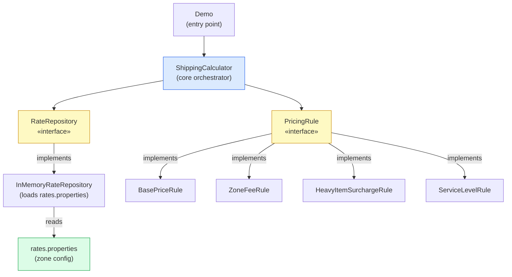
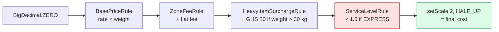
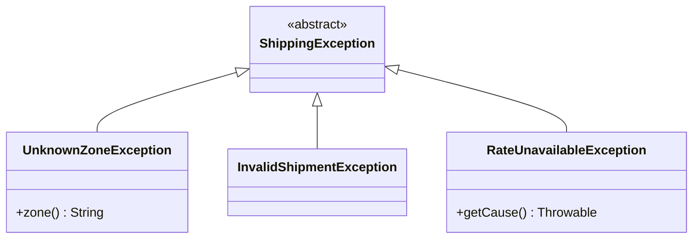
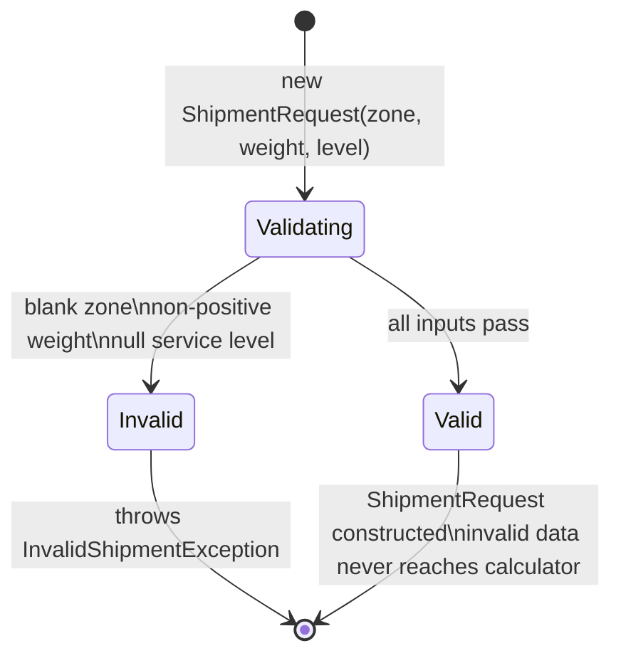

# Tidewater Freight — Shipping Cost Calculator

## Prerequisites

| Tool  | Version                  |
|-------|--------------------------|
| JDK   | 21 (Temurin recommended) |
| Maven | 3.9 or later             |

---

## Running the tests

```bash
mvn clean test
```

Expected: `Tests run: 82, Failures: 0, Errors: 0, Skipped: 0`

---

## Full verification build (tests + coverage gate + mutation gate)

```bash
mvn clean verify
```

`mvn verify` fails the build if any of these gates fail:

| Gate             | Tool   | Threshold |
|------------------|--------|-----------|
| Line coverage    | JaCoCo | ≥ 90%     |
| Branch coverage  | JaCoCo | ≥ 90%     |
| Mutation kill rate | PIT  | ≥ 95%     |

Reports after `mvn verify`:
- Coverage: `target/site/jacoco/index.html`
- Mutation: `target/pit-reports/index.html`

Demo is excluded from both gates — it is a console entry point with no logic.

---

## Running the demo

```bash
mvn compile exec:java
```

Expected output:
```
Result DOMESTIC 10.0kg STANDARD -> GHS 50.00
Result INTERNATIONAL 40.0kg EXPRESS -> GHS 967.50
Result MOON 10.0kg STANDARD -> cannot price shipment: Unknown zone: MOON
```

---

## Architecture

This service uses **Ports and Adapters** (Hexagonal Architecture) with a
**Pipeline** pattern for pricing rules.

### Overall structure



The core (`ShippingCalculator`) depends only on interfaces — never on concrete
classes. Adding a new zone means one line in `rates.properties`. Adding a new
surcharge rule means one new class. Neither change touches the calculator.

---

### Pricing pipeline



`ServiceLevelRule` **must be last** — the express multiplier applies to the
accumulated total including fees and surcharge. `DefaultPricingRulesTest` pins
this order explicitly.

---

### Exception hierarchy



Callers that only need "did it fail?" catch `ShippingException`. Callers that
need to react to a specific failure catch the subtype.

---

### Shipment request validation state



---

## Adding a new shipping zone

Add one line to `src/main/resources/rates.properties`:

```properties
ARCTIC = 20.00, 40.00
```

No Java changes needed. The `NewZone` test group in `ShippingCalculatorTest`
already proves this works for ARCTIC (rate 20, fee 40).

---

## Project structure

```
src/
  main/
    resources/
      rates.properties                zone rates as config — one line per zone
    java/com/tidewater/freight/
      ShippingCalculator.java         orchestrates the pricing pipeline
      Demo.java                       console entry point (excluded from gates)

      exception/
        ShippingException.java        abstract base — catch all domain failures
        UnknownZoneException.java     zone not in rates.properties
        InvalidShipmentException.java bad input to ShipmentRequest
        RateUnavailableException.java repository infrastructure failure

      model/
        ServiceLevel.java             enum: STANDARD, EXPRESS — no free strings
        ShipmentRequest.java          self-validating — invalid data never reaches calculator
        ZoneRate.java                 rate + fee together — zone cannot exist without its fee

      rate/
        RateRepository.java           interface — DIP seam
        InMemoryRateRepository.java   loads from rates.properties or injected map

      pricing/
        PricingRule.java              interface — one rule per class
        BasePriceRule.java            rate × weight
        ZoneFeeRule.java              flat zone handling fee
        HeavyItemSurchargeRule.java   surcharge when weight > 30 kg
        ServiceLevelRule.java         express ×1.5 — must be last
        DefaultPricingRules.java      assembles the pipeline in correct order

  test/
    java/com/tidewater/freight/
      ShippingCalculatorTest.java               unit tests — mocked repository
      ShippingCalculatorCharacterisationTest.java  exact prices from real rates.properties

      model/
        ServiceLevelTest.java
        ShipmentRequestTest.java
        ZoneRateTest.java

      rate/
        InMemoryRateRepositoryTest.java

      pricing/
        BasePriceRuleTest.java
        ZoneFeeRuleTest.java
        HeavyItemSurchargeRuleTest.java
        ServiceLevelRuleTest.java
        DefaultPricingRulesTest.java
```

---

## Mutation and coverage results

| Metric                  | Starter (inherited) | Refactored        |
|-------------------------|---------------------|-------------------|
| Tests                   | 3 (none could fail) | 82, all passing   |
| PIT mutations generated | 18                  | 46                |
| PIT mutations killed    | 3 (17%)             | **46 (100%)**     |
| Line coverage           | 20/33 (61%)         | 108/116 (93%)     |
| Test strength           | 27%                 | **100%**          |

---

## Written documents

| Document | Purpose |
|---|---|
| [`ANALYSIS.md`](ANALYSIS.md) | Diagnosis of inherited code — smells, SOLID violations, hollow tests — written before any changes, with original code in appendix |
| [`RATIONALE.md`](RATIONALE.md) | Reasoning behind every architectural decision, zone-change absorption, kept/fixed/rewritten table |
